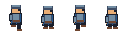

# PixelForge v0.4

**Editable, deterministic pixel sprites for coding agents and game developers.**

PixelForge turns TypeScript calls or structured JSON operations into layered sprites, timed animations, transparent PNGs, and fixed-cell spritesheets. Unlike ordinary AI image generation, every pixel is an addressable palette index. Agents can change one frame or one color without regenerating the artwork. The browser and CLI share the same renderer.

PixelForge includes a headless engine and an interactive local pixel-art editor, with no backend or external service. See [Editor guide](docs/editor-guide.md), [shortcuts](docs/keyboard-shortcuts.md), and [agent workflows](docs/agent-workflows.md).

## Get started

Use Node **22.12+** (Node 24 recommended) and npm. From the repository root:

```sh
npm install
npm run typecheck
npm test
npm run build
npm run dev
```

Open the local URL printed by Vite. The editor loads the six-frame coin and accepts `.sprite.json` files, including the bundled walking character. Draw with eight tools, edit animation entries, manage layers and palette colors, use onion skins, undo/redo, save JSON, and export PNGs. Invalid imports show validation paths while retaining the current project. All files stay local.

```sh
npm run examples    # Rebuild both projects and their PNGs using the API
npm run schemas     # Regenerate checked-in JSON Schema files
```

## CLI

Run directly from source, without building or opening a browser:

```sh
npm run cli -- init knight --width 32 --height 32 --output knight.sprite.json
npm run cli -- validate examples/coin/coin.sprite.json
npm run cli -- inspect examples/character/character.sprite.json
npm run cli -- render examples/coin/coin.sprite.json --animation spin --frame 0 --output test-output/coin-frame.png
npm run cli -- export examples/coin/coin.sprite.json --format spritesheet --output test-output/coin.png --columns 3 --padding 1
npm run cli -- apply examples/coin/coin.sprite.json --operations examples/coin/edits.json --output test-output/coin-updated.sprite.json
```

After `npm run build`, the standalone command is `node packages/cli/dist/index.js`; its package bin name is `pixelforge`. All successful commands emit JSON. Failures return a nonzero exit status. An operation batch is validated and executed on a clone, then written via a temporary sibling file and rename; a failed batch leaves an existing destination untouched. See [CLI reference](docs/cli-reference.md).

## Create a sprite with an agent

Agents should read [the format](docs/sprite-schema.md), [the API](docs/api.md), and [the operations schema](docs/operations-schema.md). JSON Schemas are in `schemas/`. Use the project API in a TypeScript script:

```ts
import { writeFile } from "node:fs/promises";
import {
  createProject,
  drawRect,
  copyFrame,
  moveRegion,
  addAnimation,
  serializeProject,
} from "@pixelforge/core";

const sprite = createProject({
  name: "Blue block",
  width: 16,
  height: 16,
  palette: [
    [0, 0, 0, 0],
    [57, 135, 192, 255],
  ],
});
drawRect(sprite, "frame-0", "base", 4, 4, 8, 8, 1);
copyFrame(sprite, "frame-0", "frame-1");
moveRegion(sprite, "frame-1", "base", 4, 4, 8, 8, 1, 0);
addAnimation(sprite, "idle", [
  { frameId: "frame-0", durationMs: 125 },
  { frameId: "frame-1", durationMs: 125 },
]);
await writeFile("block.sprite.json", serializeProject(sprite));
```

Save as `make-sprite.ts` in this repository and run `npx tsx --conditions=development make-sprite.ts`. All listed functions are real exports. Mutating operations edit the runtime project; `applyOperations` instead returns a validated independent clone. No `any`, browser globals, Sharp, or filesystem code is used in core.

## Exports and Phaser




Export order is project frame order, left-to-right then top-to-bottom. Every cell keeps the full canvas size; no trimming. Padding is transparent spacing between cells, with zero outside margin. The accompanying JSON is a **PixelForge manifest**, not a native Phaser texture atlas.

For the included coin (16×16, six frames at 125ms, no padding):

```js
preload() {
  this.load.spritesheet('coin', 'coin.png', {
    frameWidth: 16, frameHeight: 16, endFrame: 5, margin: 0, spacing: 0
  });
}
create() {
  this.anims.create({
    key: 'spin',
    frames: this.anims.generateFrameNumbers('coin', { start: 0, end: 5 }),
    frameRate: 8,
    repeat: -1
  });
  this.add.sprite(160, 120, 'coin').setScale(6).play('spin');
}
```

Set `spacing` to exported padding and `endFrame` to the last actual frame to exclude empty trailing cells. For variable timing, the [runnable Phaser example](examples/phaser/index.html) converts the manifest's indices and per-frame durations using Phaser frame duration overrides. Its code follows the official [spritesheet loading](https://github.com/phaserjs/phaser/blob/master/skills/loading-assets/references/REFERENCE.md) and [animation documentation](https://docs.phaser.io/phaser/concepts/animations). With `npm run dev` running, visit `/phaser.html` for the local example; no CDN is needed.

## Repository

```text
apps/web/              React + Vite preview and bundled example JSON
packages/core/src/     Schema, runtime models, operations, shared RGBA renderer
packages/exporters/    Sharp PNG adapter and spritesheet manifest
packages/cli/          Commander entry point and atomic project writes
examples/coin/         16×16 six-frame spin; source JSON, sheet, frame PNGs
examples/character/    32×32 four-frame walk; source JSON, sheet, frame PNGs
examples/phaser/       Runnable Phaser source
schemas/               Project and operation JSON Schema
scripts/               Reproducible examples, schema generation, build helpers
tests/                 Core, export and subprocess CLI tests; golden fixtures
docs/                  Architecture, API, formats and CLI reference
```

## Verification and limitations

`npm test` is headless and checks schema errors, pixel boundaries, drawing, clone independence, ordering, timing, compositing, golden decoded RGBA, PNG alpha, sheet cells, determinism, CLI behavior and failed-batch atomicity. Golden-image policy is in [tests/fixtures/README.md](tests/fixtures/README.md). `npm run typecheck` and `npm run build` check all source and produce the Node packages plus a static web build in `apps/web/dist`.

Optional browser integration: with `npm run dev` running, execute `npm run smoke:browser`. It uses local Chrome (override `PIXELFORGE_CHROME` for another executable), checks real Canvas bytes and controls at desktop/mobile widths, and loads the exported sheet in Phaser. Screenshots are saved in `test-output/`. This check is separate from the headless test suite.

Phase 1 supports 1–1024 pixels per canvas dimension, up to 256 palette entries, source-over layers with visibility, and integer pixel drawing without antialiasing. Export is capped at 64 megapixels. JSON Schema describes document shape; the Zod validator additionally checks cross-field dimensions, palette indices, identifiers and frame references. Public runtime objects are mutable: use API operations and validate before serializing; do not resize typed arrays or change dimensions manually.

The editor uses bounded snapshot history (50 checkpoints / 32 MiB by default); current and saved documents require additional memory. Browser multi-file exports may require allowing multiple downloads. Export writes a sheet and manifest separately; only each file write and the `apply` project replacement are atomic, not the pair of export files. Layer opacity and blend modes are not implemented. Game metadata is validated under metadata.pixelforgeGame; other metadata namespaces remain JSON data. Native Phaser JSON Hash atlas export is supported. The packages form a local workspace and are not published to npm.

## Development phases

- **Phase 2 (implemented):** Interactive drawing, layers, timeline, onion skin, history, palette editing, browser saving/export and structural agent batches.
- **Phase 3 (implemented):** Native texture atlases and Phaser integration, game metadata and asset pipelines.
- **Phase 4 (implemented):** Portable agent skill, reference workflow, local package distribution and independent Phaser acceptance checks. Autonomous skill activation in other agent hosts remains unverified.

See [CONTRIBUTING.md](CONTRIBUTING.md). MIT licensed.

## Phaser game assets (v0.3)

Run `npm run assets:playground` then `npm run dev:playground` for the playable demo (normally port 5174). The character loads PixelForge-generated atlas or sheet data with idle/walk/jump/attack, configured Arcade collision, timed combat regions and event callbacks. A/D or arrows move, Space jumps, J attacks, F3 toggles debug.

The editor Game Data panel edits origin, rectangle/circle bodies, scoped hitboxes/hurtboxes, anchors and event markers with undo/redo. Enable geometry editing for snapped overlay move/resize. Phaser export downloads a complete bundle with native atlas or fixed sheet, animations and game metadata.

CLI: `npm run cli -- export examples/phaser-playground/character.sprite.json --format phaser --layout atlas --name knight --output test-output/knight-bundle`. Output must be a new directory.

See [Phaser integration](docs/phaser-integration.md), [atlas specification](docs/texture-atlas-format.md), [collision semantics](docs/collision-and-hitboxes.md), and [pipeline](docs/game-asset-pipeline.md). Validate with `npm run smoke:playground` and `npm run smoke:game-editor` while their dev servers run.

## Portable agent workflow (v0.4)

PixelForge is an open-source, agent-first toolkit for creating editable 2D pixel sprites, animations, and game-ready Phaser assets.

**Prompt → Sprite JSON → PNG → Phaser:** ask for a sprite using pixelforge-sprite-creator, initialize/apply structured operations, validate/render, export a Phaser bundle, then load it through the adapter. [Six example prompts](examples/prompts/README.md) define outputs and objective checks.

Build local distribution with `npm run pack:release`, install the four tarballs together as described in [release preparation](docs/release-checklist.md), and install the skill with `node .agents/skills/pixelforge-sprite-creator/scripts/install.mjs install --target /path/to/game/.agents/skills`. Run `node node_modules/@pixelforge/cli/dist/index.js --version` from the game repository. No public npm package installation is implied.

[Skill installation](docs/skill-installation.md) · [Host compatibility](docs/agent-compatibility.md) · [Validation](docs/agent-validation.md) · [External Phaser acceptance](docs/external-phaser-integration.md) · [Reference workflow](docs/reference-workflow.md).


Run `npm run test:skill` and `npm run test:external` for installer and independent offline package/browser acceptance. Windows execution is verified; macOS/Linux execution and autonomous OpenCode/Antigravity use are not claimed. Skill file discovery is distinct from an agent choosing and following it. Public namespace rights and publication authorization remain explicit release gates.
