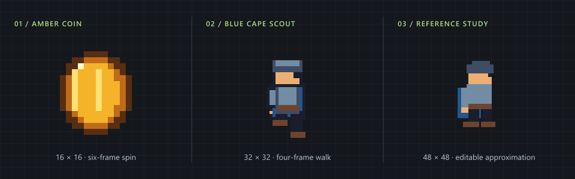
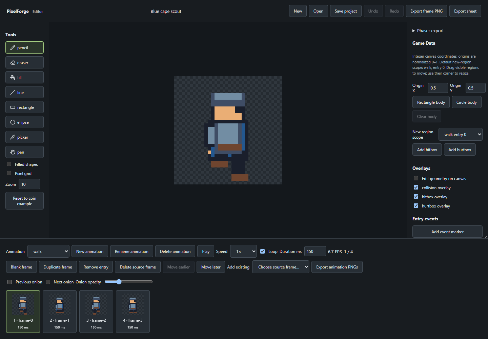
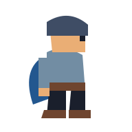
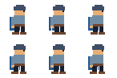

<div align="center">

# PixelForge

### Small canvas. Complete control.

Editable pixel sprites, timed animations, and Phaser-ready assets.<br>
Build with a coding agent. Refine in the editor. Keep every pixel yours.

[](CHANGELOG.md)
[](tsconfig.json)
[](package.json)
[](docs/phaser-integration.md)
[](LICENSE)

**[Quick start](#quick-start) · [Agent workflow](#create-with-an-agent) · [Phaser](#take-it-into-phaser) · [Documentation](#documentation)**



<sub>Real project output, rendered by PixelForge. All examples include editable sprite JSON.</sub>

</div>

## Pixels with a source of truth

PixelForge turns TypeScript calls and structured JSON operations into layered sprites, transparent PNGs, and game assets. Every pixel is a palette index; every animation is an ordered sequence with explicit timing. Change one color or one frame and keep the rest of the artwork intact.

The headless CLI and browser editor share one deterministic renderer. Everything runs locally, without a backend, account, or external AI service.

| Create                                                             | Refine                                                                         | Ship                                                                                      |
| :----------------------------------------------------------------- | :----------------------------------------------------------------------------- | :---------------------------------------------------------------------------------------- |
| TypeScript API, JSON operation batches, and a portable agent skill | Eight drawing tools, layers, palette editing, onion skins, timeline, undo/redo | Transparent PNGs, fixed-cell sheets, native Phaser atlases, animations, and game metadata |

## Production workflows in v0.5

Inspect large projects without dumping pixel grids, discover operation syntax from the CLI, review labeled contact sheets, check task-defined animation contracts, compare targeted edits, and rebuild only stale assets with managed exports.

[Setup](docs/setup.md) · [Large sprites](docs/large-projects.md) · [Contact sheets](docs/contact-sheets.md) · [Semantic checks](docs/semantic-checks.md) · [Safe re-exports](docs/safe-exports.md) · [Asset manifests](docs/asset-management.md) · [v0.5 verification](docs/v0.5-verification.md)

## Quick start

Use **Node 22.12+** and npm. Node 24 is recommended. From the repository root:

```sh
npm install
npm run dev
```

Open the URL printed by Vite. The editor loads an animated coin; open [`examples/character/character.sprite.json`](examples/character/character.sprite.json) to try the walking scout. Draw, adjust frames, preview playback, and save the editable project or export a PNG.

<p align="center">
  
</p>

<p align="center"><sub>The actual local editor. Canonical sprite JSON is shared with the CLI and TypeScript API.</sub></p>

## Create with an agent

```text
Using pixelforge-sprite-creator, create a 32×32 character with a blue cape,
a transparent background, and six walking frames at 8 FPS.
Save the editable project, render a preview, and export a Phaser bundle.
```

**Prompt → editable Sprite JSON → preview PNG → Phaser bundle**

The repository includes the [`pixelforge-sprite-creator` skill](.agents/skills/pixelforge-sprite-creator/SKILL.md), with format references, templates, examples, and validation helpers. [Install it in your game repository](docs/skill-installation.md), or follow the [agent workflow](docs/agent-workflows.md) directly. [Six example prompts](examples/prompts/README.md) cover static assets, animation, reference images, combat characters, Phaser integration, and corrections.

### A reference stays editable

Start with a reference, define the canvas and palette, then construct shapes and derive animation frames. The original reference below is MIT licensed; the pixel interpretation intentionally simplifies its cape and gait.

<table>
  <tr>
    <th>Original reference</th>
    <th>PixelForge project</th>
  </tr>
  <tr>
    <td align="center"></td>
    <td align="center"></td>
  </tr>
</table>

[Explore the source project and construction batch →](examples/reference-scout/README.md) · [Reference workflow](docs/reference-workflow.md)

### Use the CLI

Run from source without opening a browser:

```sh
npm run cli -- init knight --width 32 --height 32 --output knight.sprite.json
npm run cli -- apply knight.sprite.json --operations edits.json --output knight-updated.sprite.json
npm run cli -- validate knight-updated.sprite.json
npm run cli -- render knight-updated.sprite.json --output knight.png
```

`edits.json` is your structured operation batch; see the [operations guide](docs/operations-schema.md). Commands report JSON, errors exit nonzero, and failed batches preserve the destination. After building, use `node packages/cli/dist/index.js`; the package executable is named `pixelforge`.

<details>
<summary><strong>Try a complete workflow with the bundled coin</strong></summary>

```sh
npm run cli -- validate examples/coin/coin.sprite.json
npm run cli -- inspect examples/character/character.sprite.json
npm run cli -- apply examples/coin/coin.sprite.json --operations examples/coin/edits.json --output test-output/coin-updated.sprite.json
npm run cli -- render examples/coin/coin.sprite.json --animation spin --frame 0 --output test-output/coin-frame.png
npm run cli -- export examples/coin/coin.sprite.json --format spritesheet --output test-output/coin.png --columns 3 --padding 1
```

See the [CLI reference](docs/cli-reference.md) for all commands and options.

</details>

<details>
<summary><strong>Build a sprite with the TypeScript API</strong></summary>

```ts
import { writeFile } from "node:fs/promises";
import {
  createProject,
  drawRect,
  copyFrame,
  moveRegion,
  addAnimation,
  serializeProject,
} from "@pixelforge/core";

const sprite = createProject({
  name: "Blue block",
  width: 16,
  height: 16,
  palette: [
    [0, 0, 0, 0],
    [57, 135, 192, 255],
  ],
});

drawRect(sprite, "frame-0", "base", 4, 4, 8, 8, 1);
copyFrame(sprite, "frame-0", "frame-1");
moveRegion(sprite, "frame-1", "base", 4, 4, 8, 8, 1, 0);
addAnimation(sprite, "idle", [
  { frameId: "frame-0", durationMs: 125 },
  { frameId: "frame-1", durationMs: 125 },
]);
await writeFile("block.sprite.json", serializeProject(sprite));
```

Save as `make-sprite.ts` in this repository and run `npx tsx --conditions=development make-sprite.ts`. Core has no React, DOM, Sharp, or filesystem dependency. [Read the API reference →](docs/api.md)

</details>

## Take it into Phaser

Export a bundle containing a native atlas or fixed-cell sheet, animation timing, and game metadata:

```sh
npm run cli -- export examples/phaser-playground/character.sprite.json --format phaser --layout atlas --name knight --output test-output/knight-bundle
```

Use a **new output directory** initially; add `--replace` to update an unchanged, verified managed bundle safely. The typed [`@pixelforge/phaser` adapter](packages/phaser) loads the bundle and applies configured origins, Arcade bodies, combat regions, anchors, and event markers. [Integration guide →](docs/phaser-integration.md)

Try the playable demo:

```sh
npm run assets:playground
npm run dev:playground
```

**A/D or ←/→** move · **Space** jumps · **J** attacks · **F3** toggles debug

<details>
<summary><strong>Prefer a simple fixed-size spritesheet?</strong></summary>

The bundled coin has six 16×16 frames, each lasting 125 ms:

```js
preload() {
  this.load.spritesheet('coin', 'coin.png', {
    frameWidth: 16, frameHeight: 16, endFrame: 5,
    margin: 0, spacing: 0
  });
}
create() {
  this.anims.create({
    key: 'spin',
    frames: this.anims.generateFrameNumbers('coin', { start: 0, end: 5 }),
    frameRate: 8,
    repeat: -1
  });
  this.add.sprite(160, 120, 'coin').setScale(6).play('spin');
}
```

Sheet cells preserve the full canvas and transparent margins, ordered left-to-right then top-to-bottom. Set `spacing` to exported padding; set `endFrame` to the last actual frame. A sheet's JSON is a **PixelForge manifest**; native Phaser JSON Hash atlases are a separate export option. For variable timing, see the [runnable example](examples/phaser/demo.ts). With `npm run dev` running, open `/phaser.html`.

</details>

## Documentation

| I want to…                          | Start here                                                                                                                                                                   |
| :---------------------------------- | :--------------------------------------------------------------------------------------------------------------------------------------------------------------------------- |
| Draw and animate in the browser     | [Editor guide](docs/editor-guide.md) · [Keyboard shortcuts](docs/keyboard-shortcuts.md)                                                                                      |
| Create or edit assets with an agent | [Agent workflow](docs/agent-workflows.md) · [Example prompts](examples/prompts/README.md)                                                                                    |
| Install the portable skill          | [Installation](docs/skill-installation.md) · [Host compatibility](docs/agent-compatibility.md) · [Validation helpers](docs/agent-validation.md)                              |
| Understand projects and operations  | [Sprite format](docs/sprite-schema.md) · [Operations](docs/operations-schema.md) · [TypeScript API](docs/api.md) · [JSON Schemas](schemas)                                   |
| Integrate game assets               | [Phaser](docs/phaser-integration.md) · [Atlas format](docs/texture-atlas-format.md) · [Collisions](docs/collision-and-hitboxes.md) · [Pipeline](docs/game-asset-pipeline.md) |
| Contribute or prepare a release     | [Contributing](CONTRIBUTING.md) · [Architecture](docs/architecture.md) · [Release checklist](docs/release-checklist.md) · [Changelog](CHANGELOG.md)                          |

<details>
<summary><strong>Repository map</strong></summary>

```text
apps/web/                 Local React + Vite editor
packages/core/            Schemas, pixel operations, animation, shared renderer
packages/exporters/       Sharp PNG, sheet, and bundle exports
packages/cli/             Headless CLI and atomic operation batches
packages/phaser/          Typed Phaser adapter
examples/                 Editable sprites, operation batches, playable demo
.agents/skills/           Portable sprite-creation skill
schemas/                  Canonical JSON Schemas
scripts/                  Reproducible assets, builds, and browser checks
tests/                    Headless tests, golden fixtures, external acceptance
docs/                     Guides, specifications, and verification evidence
```

</details>

## Build and verify

```sh
npm run typecheck
npm test
npm run build
npm run test:skill
```

The headless suite covers schema rejection, pixel boundaries, frame independence, animation timing, compositing, decoded RGBA golden fixtures, PNG alpha, sheet placement, and failed-batch atomicity. Production builds include the editor and Phaser playground.

<details>
<summary><strong>Browser checks, asset regeneration, and local packages</strong></summary>

With `npm run dev` and `npm run dev:playground` running:

```sh
npm run smoke:browser
npm run smoke:game-editor
npm run smoke:playground
```

Browser checks use installed Chrome; set `PIXELFORGE_CHROME` to override its executable. Screenshots go into ignored `test-output/`.

```sh
npm run examples              # Coin, character, and editor example assets
npm run examples:reference    # Original reference, editable scout, static gem
npm run schemas              # Canonical JSON Schemas
npm run pack:release         # Four local package tarballs
npm run test:external        # Independent packed-package + Phaser acceptance
```

`test:external` needs the tarballs and installed Chrome. Dependency installation is online by default; set `PIXELFORGE_OFFLINE=1` only with a compatible populated cache. It compiles a TypeScript consumer and runs Phaser outside the monorepo. [Acceptance details →](docs/external-phaser-integration.md)

For another repository, install the complete local tarball set using the [release guide](docs/release-checklist.md). These packages are **not published to npm**. To regenerate the README gallery, run `npx tsx --conditions=development scripts/readme-assets.ts`; add `--capture-editor` while the editor dev server runs to refresh its screenshot.

</details>

## Current scope

PixelForge v0.5 release candidate includes the core, interactive editor, Phaser integration, portable agent skill, and reference workflow. Windows toolchain execution is verified. macOS/Linux execution and autonomous skill activation in other agent hosts remain unverified; see [compatibility](docs/agent-compatibility.md) and [verification](docs/verification.md).

Canvases support **1–1024 pixels per dimension**, with up to **256 palette entries**; exports are capped at **64 megapixels**. Layer opacity/blend modes, selection/transform tools, and cloud persistence are not implemented. History is bounded to 50 checkpoints / 32 MiB of retained text. Browser multi-file downloads may require permission. Each output replacement is atomic; a multi-file export is not a single transaction. Public namespace rights and publication authorization remain release gates.

---

<div align="center">

**Made for precise pixels and editable assets.**<br>
[MIT licensed](LICENSE) · [Contributions welcome](CONTRIBUTING.md) · [Release notes](CHANGELOG.md)

</div>
